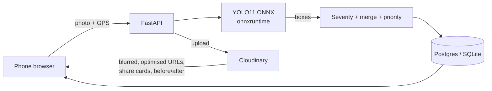

# NagarNetra - See it. Snap it. Fix it.

**AI-powered civic issue reporting.** A citizen snaps a photo of a pothole. An open-weight YOLO11 model finds the damage and scores its severity. Cloudinary blurs faces, optimises the image and builds a shareable card. The city gets a live map ranked by what to fix first.

Built for **Hacktober HackDays 2026** by SheBuilds.

---

## The problem

Indian cities receive thousands of civic complaints, but they arrive as unstructured calls, tweets and WhatsApp photos. There is no way to tell a dangerous crater from a hairline crack, the same pothole gets reported 50 times as 50 separate tickets, and citizens never see whether anything got fixed. So they stop reporting.

## The solution

| Step | What happens |
|---|---|
| 1. Snap | Citizen takes a photo on any phone browser. No app install. Location from GPS or a tap on the map. |
| 2. Detect | A YOLO11 model (open weights, trained on an open pothole dataset) draws boxes around the damage. |
| 3. Score | Severity 0-100 from damage area, number of potholes and model confidence. |
| 4. Merge | A report within 25 m of an open issue of the same type is merged, not duplicated. Each extra citizen raises priority. |
| 5. Rank | Priority = severity + crowd signal + waiting time. The city sees a "fix first" list. |
| 6. Close the loop | The municipality uploads an "after" photo. Cloudinary composes a before/after image that anyone can see. |

## How we use Cloudinary

Cloudinary is the media backbone, not just storage:

- **Upload with metadata**: every photo is tagged (`pothole`, `severity-high`) and carries location context, so the Cloudinary Media Library itself becomes a searchable issue database.
- **Privacy by default**: `e_blur_faces` is applied to every public delivery URL. Passers-by in photos are never exposed.
- **Smart thumbnails**: `c_fill,g_auto` crops on the most important part of the image for the issue list.
- **Fast on 3G**: `f_auto,q_auto` serves WebP/AVIF at the right quality, important for citizens on slow mobile data.
- **Shareable severity cards**: text overlays generate a 1200x630 social card ("POTHOLE | Severity High 82 of 100 | 7 citizen reports") on the fly. No image editing code on our side.
- **Before/after proof**: image layers (`l_`, `fl_layer_apply`, `c_pad`) stitch the original and the repair photo side by side with BEFORE / FIXED labels.

All of this lives in [`backend/app/cloud.py`](backend/app/cloud.py).

## Open-source AI

- Model: **YOLO11n** (Ultralytics, AGPL-3.0), fine-tuned on Ultralytics' open pothole dataset. Training script: [`training/train_pothole.py`](training/train_pothole.py).
- Exported to **ONNX** and served with **onnxruntime** + numpy (our own letterbox + NMS code in [`backend/app/detector.py`](backend/app/detector.py)). No PyTorch at runtime, so it runs on a free 512 MB server.
- Map: **Leaflet** + **OpenStreetMap**.

## Architecture



## Tech stack

FastAPI, SQLAlchemy (SQLite locally, Supabase Postgres in production), Cloudinary Python SDK, onnxruntime, Pillow, numpy, vanilla JavaScript, Leaflet.

## Run it locally

You need Python 3.10+ and a free Cloudinary account.

```bash
python3 -m venv .venv
source .venv/bin/activate
pip install -r backend/requirements.txt
cp .env.example .env
```

Open `.env` and paste your `CLOUDINARY_URL` (Cloudinary dashboard > API Keys > "API environment variable").

```bash
cd backend
uvicorn app.main:app --reload
```

Open http://localhost:8000

### Train the model (30 min, free GPU)

Open Google Colab, set Runtime > T4 GPU, upload `training/train_pothole.py`, then run `!pip install -q ultralytics` and `!python train_pothole.py`. Download `best.onnx` and save it as `backend/models/pothole.onnx`. Without a model file the app still runs; severity falls back to a per-category estimate.

## API

| Method | Path | Purpose |
|---|---|---|
| POST | `/api/reports` | Photo + lat/lng -> detection, severity, upload, merge |
| GET | `/api/reports?status=open&sort=priority` | Ranked issue list |
| POST | `/api/reports/{id}/upvote` | "Me too" |
| POST | `/api/reports/{id}/resolve` | Admin uploads repair photo (header `X-Admin-Key`) |
| GET | `/api/stats` | Impact numbers |
| GET | `/api/health` | Cloudinary + model status |

Interactive docs at `/docs`.

## Deploy

Render: New > Blueprint > pick this repo (uses `render.yaml`). Set `CLOUDINARY_URL`, `ADMIN_KEY` and `DATABASE_URL` (Supabase > Project Settings > Database > connection string, "Session pooler").

## What's next

- WhatsApp bot intake (most citizens already send photos there)
- More classes: garbage, waterlogging, broken streetlights
- Auto-routing to the right ward office, SLA timers, public ward scorecards

## Build journal

Our day-by-day building journey is documented on Notion: _add your Notion link here_

## Team

_Add names, roles and GitHub handles._

## License

AGPL-3.0 (because the model is trained with Ultralytics YOLO, which is AGPL-3.0).
